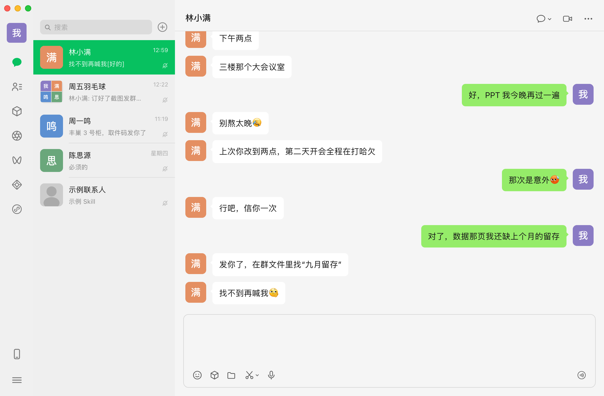
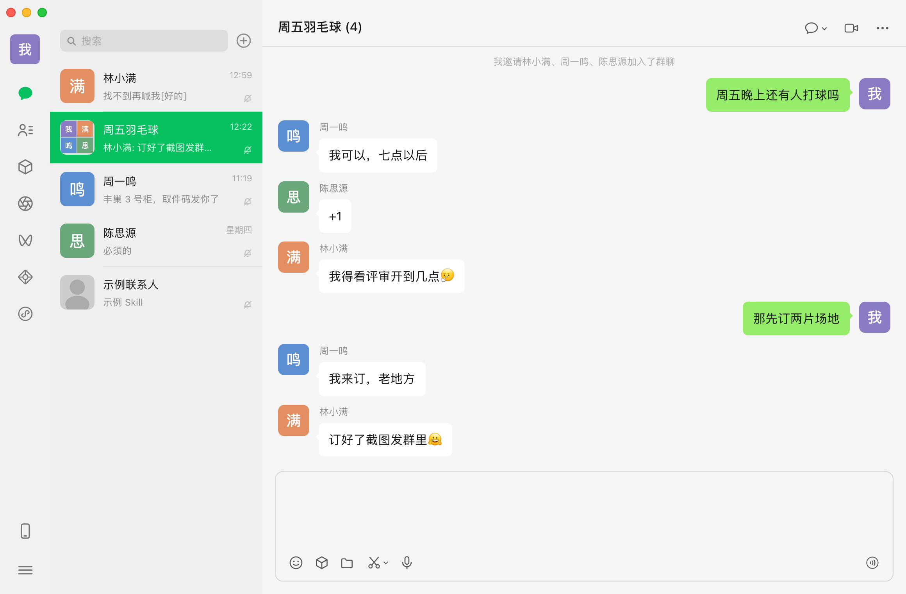

# WeChat Skill Chat

照着 Mac 版微信做的一个聊天界面，联系人是 AI 人格（skill）。导入一个 skill 文件夹，它就成了通讯录里的一个好友，可以单聊，也可以拉几个人建群。它回你消息的方式跟人在微信上打字差不多：一句一个气泡，不写 Markdown，表情用微信的黄脸。





截图里的联系人和对话都是编的。

## 快速开始

```bash
git clone https://github.com/AndreiB180/wechat-skill-chat.git
cd wechat-skill-chat
pip install flask anthropic
python3 server.py
```

跑起来会自动打开浏览器（默认 http://localhost:5888，端口被占了就换一个，终端里会打出来）。第一次打开能看到一个示例联系人。点左上角自己的头像进设置，把 API 填好（见下面「接哪个模型」），然后去通讯录导入 skill。

我是在 macOS 上写和测的，Python 3.9 以上就行。Linux 应该也能跑，但我没仔细测过；Windows 跑不了，因为文件锁用的是 `fcntl`。

几个可选的依赖，用到再装：

| 想要的功能 | 要装的 |
|---|---|
| 给 AI 发 `.docx` 附件 | `pip install python-docx` |
| 给 AI 发 `.pdf` 附件（有文字层的） | `pip install PyPDF2` |
| macOS 独立窗口版 | `pip install pywebview` |
| 语音消息 | 本机装好 GPT-SoVITS，见「语音」一节 |

## 接哪个模型

设置里的「运行模式」有两种。

**API 模式**：直接调模型的 API。用的是 Anthropic Messages 格式（`POST /v1/messages`），所以兼容这个格式的服务都能接：

| 服务 | Base URL | Model 填什么（举例） |
|---|---|---|
| Anthropic | 留空 | `claude-sonnet-5-5` |
| DeepSeek | `https://api.deepseek.com/anthropic` | `deepseek-v4-pro` |
| 其他兼容的网关 | 它给的 `/anthropic` 或 `/v1/messages` 地址 | 看它的文档 |

OpenAI 那种 `/v1/chat/completions` 格式接不了。

**Claude Code 模式**：本机装了 Claude Code 的话，每个联系人可以各自跑在一个 Claude Code 会话里，能读你发的文件，也能跑命令。设置里填命令名（默认 `claude`），权限有两档：「自动」会放行安全的操作、拦下有风险的；「跳过权限」全部放行，自己掂量着用。

API Key 在 macOS 上保存后写进登录钥匙串，`settings.json` 里只留一个标记。其他系统没有钥匙串，Key 存在 `settings.json` 里，只做了 base64 混淆，等于明文，这个文件别给别人。

## 导入 skill

skill 是一个文件夹，里面至少要有下面两种写法之一（两种都有的话只读 `SKILL.md`）：

```
my-skill/
├── SKILL.md      # 整个人格写在一个文件里（推荐）
└── meta.json     # 可选
```

```
my-skill/
├── persona.md    # 性格和说话方式，必须有
├── work.md       # 会干什么，可选，导入时和 persona.md 合并
└── meta.json     # 可选
```

`meta.json` 是可选的，用来指定显示名：

```json
{
  "display_name": "林小满",
  "name": "colleague-linxiaoman",
  "tags": ["同事", "说话简短", "爱发表情"]
}
```

没有 `meta.json` 就用文件夹名。`SKILL.md` 可以用 `/dot-skill` 从聊天记录里蒸馏，也可以自己写一段角色描述。

导入：通讯录 →「添加 Skill」→ 填文件夹的完整路径。导入后会自动生成一个首字头像，想换就把图片拖进联系人编辑框的头像地址那一栏。

每次调模型之前，程序会在人格前面塞一段格式要求：不许用 Markdown，不许写「（顿了顿）」这类括号动作和旁白，表情写成 `[捂脸]` 这样，回复要短。模型回的内容按换行拆成几个气泡。

## 群聊

聊天列表上方的「+」可以拉几个联系人建群。你发一条消息以后，先有一次轻量的模型调用决定谁来接话，消息里提到了谁的名字，谁就一定回；之后再轮几轮，尽量让还没说话的人说，不让一个人刷屏。输入 `@` 会弹出成员列表。群聊的回复是流式的，一条一条冒出来。

## 搜索聊天记录

顶部的搜索框能搜联系人和聊天内容。「查看全部」在 macOS 窗口版里会开一个单独的窗口，跟微信一样；在浏览器里是新开一个标签页。

## macOS 窗口版（可选）

```bash
pip install pywebview
python3 app_native.py
```

这样开出来是一个独立窗口，没有浏览器的地址栏，左上角是系统自己的红绿灯，侧栏有毛玻璃效果。浏览器里的红绿灯是画上去的装饰，点了没反应。

想放进 Dock 的话跑一次 `./build_app.sh`，会生成一个 `微信.app`。它只是个启动用的壳，跑的还是本机的 Python，换了项目路径或 Python 环境就重新跑一次。第一次打开 macOS 会问能不能访问「文稿」文件夹，要点允许，不然读不到项目里的文件。日志在 `~/Library/Logs/wechat-skill-chat.log`。

## 语音（可选，默认关）

每个联系人可以单独配一个音色，配好以后它回你时会按你设的概率发语音。语音用本机的 GPT-SoVITS 合成，不联网。

1. 设置里填 GPT-SoVITS 的目录，点「启动检测」。`voice_config.json` 里的 `engine.python` 要指向装了 torch 的那个 Python。
2. 通讯录 → 某个联系人 →「语音」：选 GPT 权重（`.ckpt`）、SoVITS 权重（`.pth`）和一段 3–10 秒的参考音频。
3. 点「测试合成」。真合成出声音了才能勾「启用语音」，改了任何模型参数都要重新测。
4. 拖滑块设概率：0 是从来不发语音，100 是每条都发。

我在 M3 Pro 上纯 CPU 跑，模型第一次加载大概 10 秒，之后合成 5 秒的语音大概要 7 秒。合成失败的那条会退回文字，不会卡住。语音气泡右键可以转文字。没装 GPT-SoVITS 也不影响别的功能，点「启动检测」只会提示找不到目录。

## 隐私

下面这些只存在你自己电脑上，`.gitignore` 里都排除了：

- `settings.json`：设置和 Key 的标记
- `skills_config.json`、`groups_config.json`：你的联系人和群。仓库里只有 `skills_config.example.json`、`groups_config.example.json` 两个示例，本机还没有正式文件时程序读示例
- `chat_history/`：聊天记录，每个联系人或群一个 JSON。活跃文件里留最近 400 条，更早的追加到 `chat_history/archive/`，不会删
- `skills/`（`example.md` 除外）、`static/avatars/`（`default.svg` 除外）：导入的人格和上传的头像
- `cc_logs/`、`voice_config.json`、`static/voice_cache/`：Claude Code 日志、语音配置和合成出来的音频

导入的人格如果是照着真人做的，这些文件里就有真人的信息，往外发这个文件夹之前看一眼。

## 目录

```
server.py            浏览器模式入口
app_native.py        macOS 窗口版入口（pywebview）
build_app.sh         生成 微信.app
voice_worker.py      语音合成子进程
backend/             Flask 后端：设置、联系人、单聊、群聊、搜索、语音、钥匙串
templates/           主界面和搜索窗口
static/              样式、前端脚本、表情、默认头像
skills/example.md    示例人格
```
